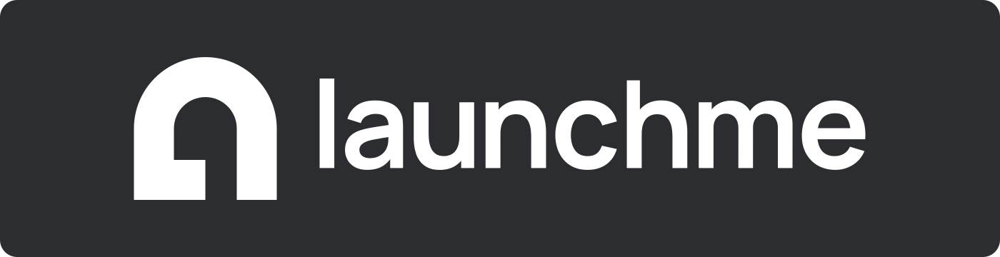

**[Changelog](changelog/)** · **[Download](../../releases/latest)**

A full-screen, console-style game launcher for Windows 10/11, built for a gamepad.
It merges Steam (collections and non-Steam shortcuts), GOG, Battle.net, EA app, Ubisoft Connect,
Epic Games, Amazon Games, Xbox (PC) and your own programs into one library, with artwork from SteamGridDB (and Epic's
own store art for an Epic account's games).

> **Linux: highly experimental (WIP).** Since 0.4.0 the same launcher also builds and runs natively on Linux,
> with Proton/Wine for Windows games (umu-launcher, GE-Proton, prefixes, per-game options). It is a work in
> progress: expect bugs and missing pieces, and keep Windows as the supported platform for now.
> See [Linux](#linux-highly-experimental-wip).

Native C++20: Win32, Direct2D/DirectWrite/WIC, WinHTTP, XAudio2 and Media Foundation — no HTML UI.
The interface is available in English, Polish, Brazilian Portuguese and Spanish (Settings → System → Language).
The AI companion and Tarot speak English or Polish.

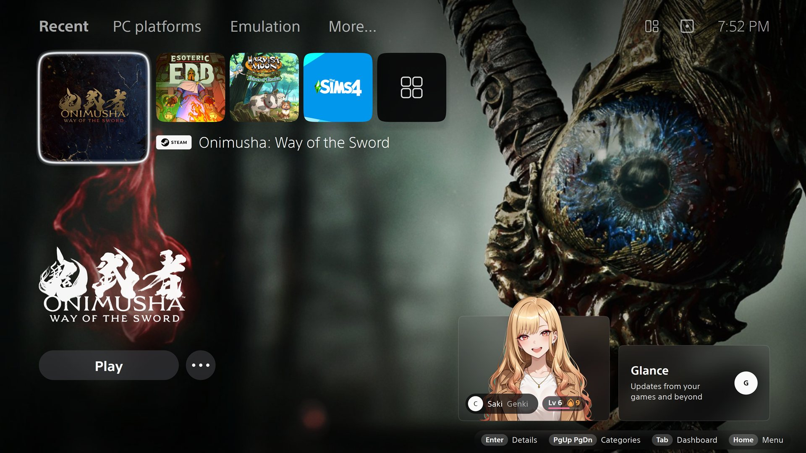

## Screenshots

| | |
| --- | --- |
| 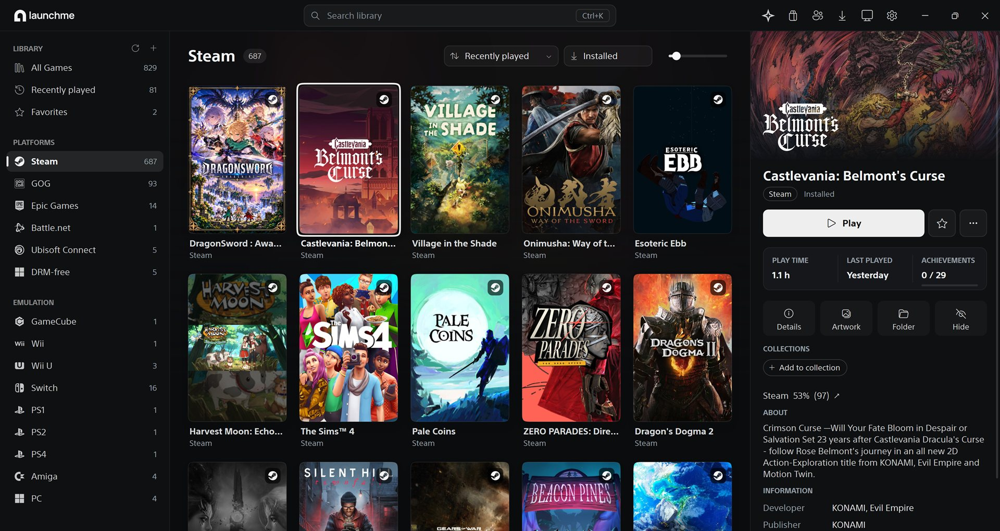 **Desktop window** | 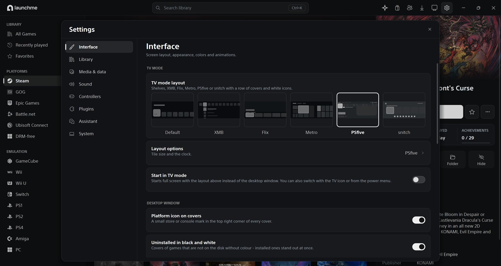 **Settings (desktop window)** |
| 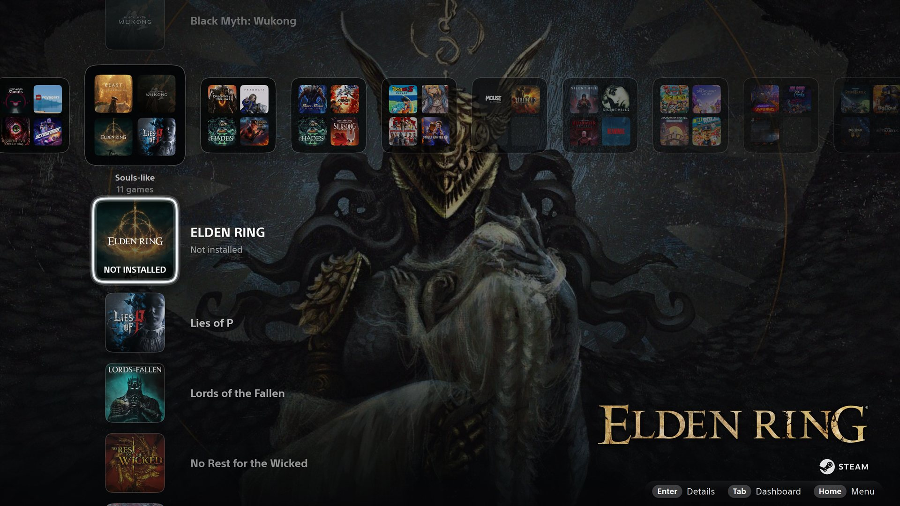 **XMB** | 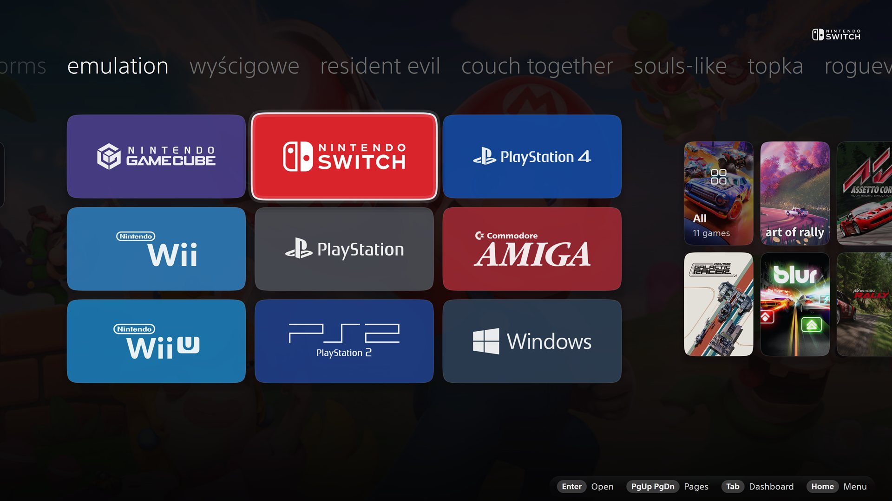 **Metro** |
| 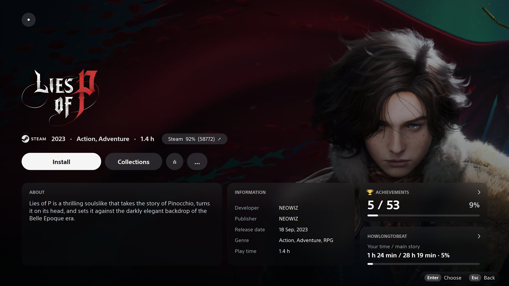 **Game details** | 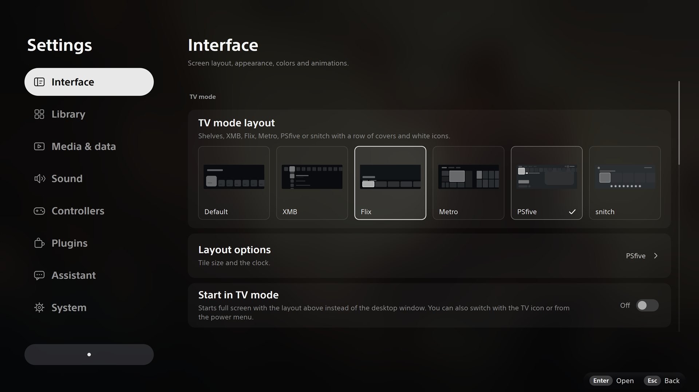 **TV mode layouts** |
| 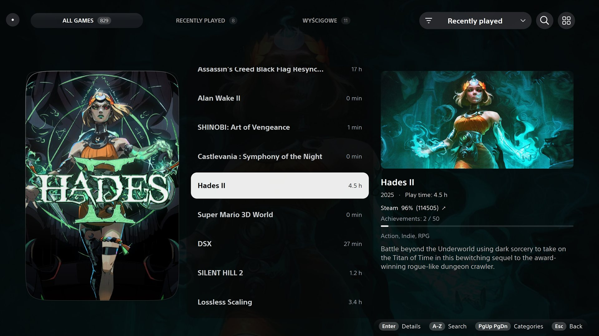 **List+ library view** | 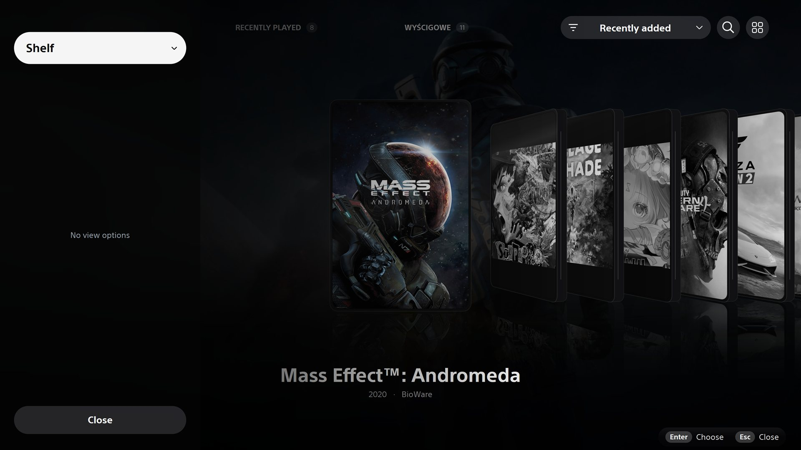 **Coverflow** |
| 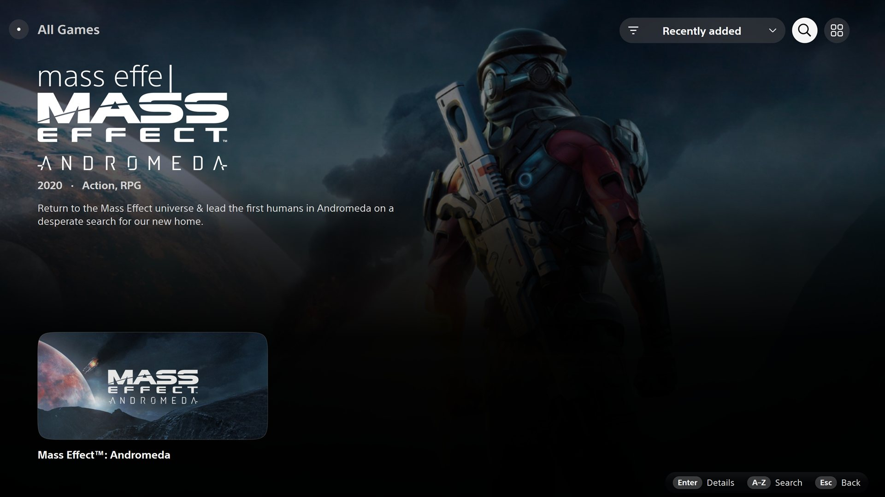 **Search** | 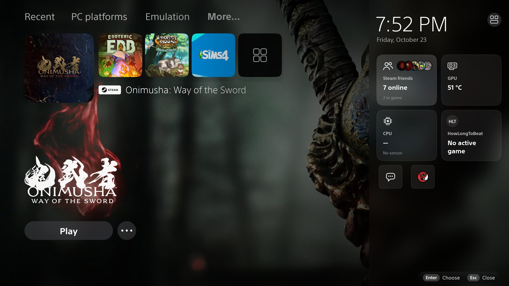 **Widgets drawer** |
| 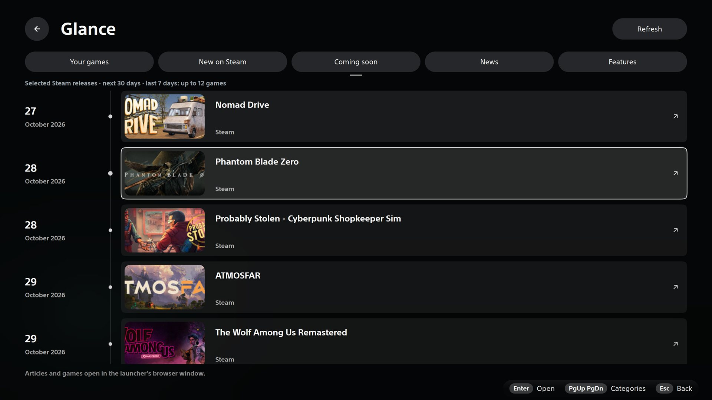 **Glance** | 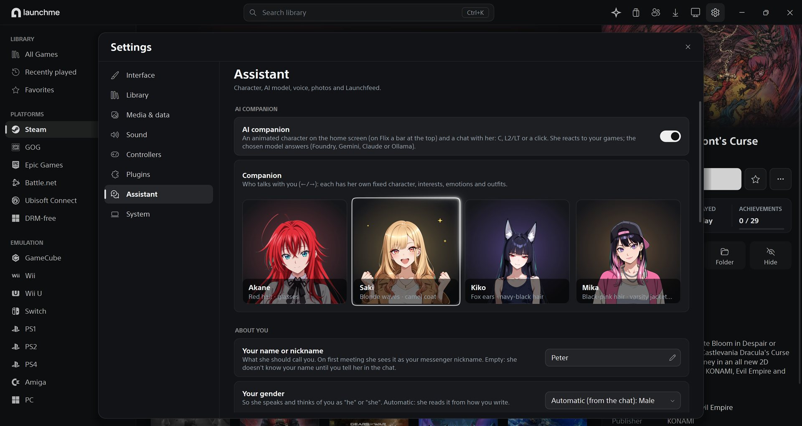 **AI companion** |

## Download

Grab `launchme-<version>-win64.zip` from [Releases](../../releases), unpack it anywhere and run
`launchme.exe`. No installer and no Visual C++ Redistributable are needed. The bundled plugins
(`plugin-packages/`) install themselves on first start; manage plugins in Settings → Plugins.

## Where settings and cache are stored

Everything launchme writes goes to **`%LOCALAPPDATA%\Launchme`** (e.g. `C:\Users\<you>\AppData\Local\Launchme`),
never next to the EXE:

| What | Where |
| --- | --- |
| Settings | `settings.ini` |
| API keys | `*_api_key.txt` (plain text) or `*.dat` (encrypted with Windows DPAPI for your account) |
| Store accounts (GOG, Epic, EA) | `accounts\` (DPAPI) |
| Optional Aurelia binary / isolated session | `helpers\aurelia\` / `aurelia\` |
| Optional Nile binary / Amazon Games session | `tools\nile-1.2.0.exe` / `amazon\` |
| Optional Xbox helper / Xbox account session | `tools\launchme-xbox-0.1.0.exe` / `xbox\` |
| Artwork cache | `covers`, `heroes`, `logos`, `posters`, `landscapes`, `stores`, `artwork` |
| Metadata and ratings cache | `metadata`, `ratings`, `knowledge`, `glance` |
| Downloaded game videos | `media\` (folder can be changed in Settings → Media & data) |
| Glance browser profile | `browser\` |
| Play journal and achievement history (Profile) | `play-journal.tsv`, `achievement-history.json` |
| Logs and crash dumps | `launchme.log`, `crashes\` |

Cache folders can be deleted — they are rebuilt from disk or the network — except your manual choices
(`artwork\selections`, `*.manual-focus` crops, `metadata\*.rawg.json`). Set `LAUNCHME_CONFIG_DIR`
to an absolute path to use a different data folder (e.g. a portable or test profile).
Settings → System → Help → **Open folder** (the version row) opens it.

## Features

- **Home layouts**: shelves (default), XMB, Flix, Metro, PSfive and snitch, with a PS5-like tile
  entrance, frosted glass, button colour themes and several focus-outline styles. In Flix, resting
  on a game for a few seconds unfolds its poster into a wide card with its background, logo and facts,
  pushing the neighbouring tiles aside.
- **Made for a pad**: XInput, DualSense, DualShock 4 and generic HID pads, an on-screen keyboard, and a bottom
  bar with Search, All games, plugins, Downloads, Controllers, Sound, Widgets, Settings and Power. Keyboard and
  mouse work everywhere too. Paired Bluetooth pads stay listed, greyed, while Bluetooth is off.
- **Launch screen**: starting a game shows its background, slowly zooming in, with its logo until the game's
  window shows, then fades away behind it.
- **Desktop window mode** with a sidebar, search and a details pane; switch between it and full screen from
  the power menu. The sidebar folds to its icons (the button by the logo) and the details pane is as wide as
  you drag its edge (double-click it for the default).
- **Library views**: grid (squares, posters or landscape tiles), list, cinematic, detailed, poster,
  coverflow, a shelf of game cases (their spines carry the name and the platform) and novelty
  cartridge/floppy views; sorting, filters, search, *Recently added* by the store's acquisition date and
  remembered positions. Consoles, collections and publishers each open in a default view of their own until one
  gets its own (Settings → Interface → *Library views in TV mode*, with a reset for each). With game videos on, the video plays in List+'s picture, in Cinematic's focused tile
  and in the desktop window's details pane; PC games from other stores play the Steam trailer of the same game.
  Games you hide, and Steam's hidden and private games, stay out of sight until you show them.
- **Playing**: Play on a game installed by another remembered Steam account switches Steam to that account
  first, and a Steam game can be tied to one account (game menu → *Steam account*); Install picks the Steam
  library (with its free space) in Launchme's own dialog. While a game runs, *Close game* sits next to Play.
  Account switching and the install dialog can be turned off in Settings → Library → Launching.
- **Downloads**: Steam, GOG, Epic, Battle.net, Amazon Games, Xbox (through Launchme) and Aurelia installs show their phase and percent on
  the game's Play button and in one *Downloads* list; a game preloaded ahead of its release waits there as
  *Preloaded* until the release day.
- **Stores**: local installs of every store above, Steam collections synced with the running client,
  GOG and Epic account libraries (Epic installs through Legendary, no Epic launcher needed), Amazon Games
  through the optional, separately downloaded Nile helper ([guide](docs/AMAZON_GAMES.md)), the Xbox account (bought,
  Play Anywhere and PC Game Pass games) through Launchme's optional Xodus-based helper ([guide](docs/XBOX.md)),
  EA and Battle.net libraries imported from their store pages (no EA app needed: sign in on ea.com,
  paste the token page), Ubisoft from the signed-in client, DRM-free folders, and MultiMC / Prism Launcher
  instances as games. Every platform, Steam included, can be switched off.
- **Games added by hand** (Settings → Library → *Manually added games* → **Add game**): any program, shortcut or
  script, or no file at all, for a game to play next or one played elsewhere; such a game reads **Choose file** and
  opens its editor at the file. The editor shows the poster its name finds as you type, with **Identify game** under it;
  **Remove from library** (the game's menu, in red, after a question) removes the entry, never the game's files.
- **Shortcuts** (the desktop window's game menu → *Shortcuts*; TV mode: the game's details → … → *Shortcuts*): a
  desktop shortcut, a Start menu entry (on Linux the applications menu) and a Steam shortcut with the game's artwork
  for any game, starting it through Launchme with its launch options; Settings → Library → *Game shortcuts* adds
  every installed game at once.
- **Save backups through Ludusavi** (Settings → Library → *Save backups*): a game's saves backed up after it ends
  (off by default) or by hand from its menu → *Saves*, and restored from there.
- **Recently played** can also list games not installed, by the date they were added (Settings → Library →
  Visibility → *Not installed in Recently played*).
- **Extended Aurelia integration** (Windows, optional, off by default): install/update the latest x64 helper
  from Settings → Library → Steam → *Manage Aurelia*, and sign in there with a QR code from the Steam Mobile app or
  the account name and password. It manages only the games you choose (or all, by default)
  and adds managed Steam downloads, cloud saves synced before and after playing, cloud-save status and conflict
  resolution, Steam Family Sharing games, DLC, manifest pinning/downgrades, beta branches, Workshop and native
  live friends chat in both desktop and TV modes. Primarily for single-player/offline games; some games, especially multiplayer,
  DRM and Steamworks titles, may require the Steam client. See the [Aurelia guide](docs/AURELIA.md).
- **Artwork**: SteamGridDB covers, heroes (the sharp 3840 px ones first), logos and posters with OCR-assisted cropping,
  a variant browser and *Adjust crop* for covers and backgrounds; where SteamGridDB has nothing, the store's own
  art (Epic, Ubisoft Connect, GOG, EA, Battle.net, Amazon Games). Epic account games use Epic's box art as their poster.
  Games added by hand (and DRM-free folders) fall back to the same game's Steam store art; Settings → Library →
  *Manually added games* → **Covers** fetches all their missing covers at once. Missing art downloads in the background, covers and
  posters first. To fetch it now: Settings → Media & data → *Download missing covers*, or in the desktop
  window select several games and pick *Download artwork again* or *Download missing covers…*.
- **Details**: Steam metadata, playtime (also for non-Steam games, Epic's and Prism's counts, or your own value from
  *Edit metadata*, in both modes), achievements, Steam and RAWG ratings,
  versions of the same game across stores, uninstall from the game menu (Steam's own dialog, GOG games
  silently after Launchme asks, other stores through the uninstaller they registered). Achievements of games outside
  Steam come from the Achievements plugin: GOG and Epic (with their accounts connected),
  RetroAchievements for emulated games (user name and Web API key in the plugin's settings), RPCS3 and
  shadPS4 trophies. An achievement opens its card: a larger icon, the description, when it was earned and
  how rare it is.
- **Glance**: a news hub (your games' Steam announcements, new and upcoming releases, articles) with a
  built-in WebView2 browser window driven by the pad.
- **Tarot** (optional, off by default): a short card reading — 5 to 8 questions drawn as tarot cards (buy something
  new or play what you own, genre, era, mood, company, length…) — that ends with up to three games, from your
  library or to buy on Steam.
- **AI companion** (optional): a chat character that knows your library, with an optional voice and photo feed,
  a local semantic memory (a small multilingual model on the CPU, no service) and a relationship that grows with
  your conversations — see [AI companion](#ai-companion).
- **Publishers and developers**: rows of their logos on the TV home (a board of all of them, then a studio's games),
  folded sections in the desktop window, links in the details pane, and search by studio.
  Games with every achievement unlocked have a gold border.
- **Widgets drawer**: clock, Steam friends, Discord, CPU/GPU temperatures, controllers, audio and Bluetooth.
- **Profile** (the drawer's *Profile* widget): this week's play time, games and launches with a chart, the latest
  achievements, a year of achievement history, the games closest to 100 % and every platform with its hours.
- **In-game Guide overlay** (experimental): back to the dashboard, close the game, optional FPS from PresentMon.
- **Plugins** (ZIP + native DLL): HowLongToBeat (completion times in game details) and Achievements
  (after [SuccessStory](https://github.com/Lacro59/playnite-successstory-plugin), MIT) ship with the build;
  write your own with the [Plugin SDK](docs/plugins/README.md).
- **Updates**: Launchme looks for a new release on GitHub, says so, and updates itself with one click
  (Settings → System → Updates, or the icon on the desktop window's top bar), then shows what is new.
- **Low memory mode** (Settings → System → Performance, on by default): artwork decoded at its size on
  screen, fewer images kept in memory, and while a game runs in front of the launcher it gives its graphics
  and artwork back (GPU memory to zero). Optional *Artwork compression (BC1)* for 8× less graphics memory.
- **Hide to tray while playing** (Settings → Library → Launching, off by default): while a game started here runs,
  the launcher leaves the taskbar and Alt+Tab and comes back when the game closes.
- **Music and sound**: background music with two themes (Horizons and Exploratory Silence) or none, and
  interface sounds that can come from your own sound folder.
- Screensaver, start with Windows, single instance, crash dumps; the computer stays awake while a game runs.

## API keys (all optional, all free)

Nothing is needed to start; without a key only the related feature is off. Paste keys in
**Settings → Media & data → Service keys** (or set the environment variable, which wins over the file).

| Service | How to get the key | Used for |
| --- | --- | --- |
| **SteamGridDB** (recommended) | Sign in at [steamgriddb.com](https://www.steamgriddb.com) → Preferences → API → *Generate API Key* | covers, heroes, logos, posters, the artwork browser |
| **Steam Web API** | Sign in at [steamcommunity.com/dev/apikey](https://steamcommunity.com/dev/apikey), enter any domain (e.g. `localhost`) | Steam friends, names of uninstalled games, full achievement lists |
| **RAWG** | Create an account at [rawg.io/apidocs](https://rawg.io/apidocs) → *Get API key* | ratings and metadata for non-Steam games |
| **ScreenScraper** | Create an account at [screenscraper.fr](https://www.screenscraper.fr); API developer credentials (*devid* / *devpassword*) are requested from ScreenScraper on their forum | emulated games: ROM identification, descriptions, artwork, videos |

Files and variables: `steamgriddb_api_key.txt` / `STEAMGRIDDB_API_KEY`, `steam_web_api_key.txt` /
`STEAM_WEB_API_KEY`, `rawg_api_key.txt` / `RAWG_API_KEY`. ScreenScraper has its own page with the
developer and user login (**Settings → Media & data → ScreenScraper**, variables `SCREENSCRAPER_DEV_ID`,
`SCREENSCRAPER_DEV_PASSWORD`, `SCREENSCRAPER_SSID`, `SCREENSCRAPER_SSPASSWORD`); passwords are stored with DPAPI.

Store accounts (GOG, Epic, EA) connect in **Settings → Library → Platforms → ⚙** and are stored with DPAPI.
Steam collection sync needs the Steam client started with `-cef-enable-debugging`.

## AI companion

The companion is an optional chat character on the home screen (**Settings → Assistant**) that knows
your library and playtime. It needs a language model — the easiest is a **free Gemini API key**:

1. Open [aistudio.google.com/apikey](https://aistudio.google.com/apikey), sign in with a Google account
   and click *Create API key* (the free tier is enough for chatting).
2. In launchme: **Settings → Assistant** — Gemini is the default model provider — paste the key into
   **Gemini API key** (or set `GEMINI_API_KEY`).

Other providers: Claude (`ANTHROPIC_API_KEY`), Grok (`XAI_API_KEY`) or a local [Ollama](https://ollama.com)
server with no key. Optional voice uses an [ElevenLabs](https://elevenlabs.io) key (`ELEVENLABS_API_KEY`).
Keys typed in Settings are encrypted with DPAPI for your Windows account.

The companions live in real cities (Europe and Tokyo) and keep their own clocks, so they sleep at night there.
Far from those time zones, **Settings → Assistant → Where they live** moves them all to one of 27 cities
from Honolulu to Auckland (*Shared city*), or one of them on her own (*City: …*); the city's time zone
sets when she sleeps, and she makes up her neighbourhood there herself.

## Building

Requirements: Windows 10/11 x64, Visual Studio 2026 (18) with the C++ workload and Windows SDK,
Git and network access on the first configure (miniz, PresentMon and WebView2 SDK are fetched).
The build uses the CMake bundled with Visual Studio.

```powershell
.\tools\build.ps1          # Release build, runtime published to build\vs
.\tools\build.ps1 -Test    # also builds and runs every CTest test
.\build\vs\launchme.exe
```

Close a running launcher before rebuilding. The C++ runtime is linked statically. Tests never launch
games, store clients, installers or change system settings; `*_live_test.exe` and `tools/` probes are
manual (network, real accounts).

### Linux (highly experimental, WIP)

**Highly experimental, work in progress.** The full launcher (TV mode and the desktop window) builds and runs
natively on Linux from the same sources: SDL3 for the window, input and sound, Skia on the GPU (Vulkan, else
OpenGL) in place of Direct2D/DirectWrite. It reads Steam (native, Flatpak, Snap), Heroic (Epic and GOG), Lutris,
Prism Launcher and your own games, and runs Windows games through umu-launcher, Proton or Wine with a prefix
manager and per-game options (Settings → *Compatibility*, [docs/LINUX_WINE.md](docs/LINUX_WINE.md)): a game keeps
only its own values on top of the defaults, CachyOS and GE-Proton extras and lsfg-vk are one click, launch options
can be pasted as Steam writes them, Protontricks works for every game, ProtonDB and Steam Deck ratings are shown,
and store launchers (Battle.net, EA app, Epic, Ubisoft, Rockstar, GOG Galaxy) install in a prefix of their own.
It has been tested far less than the Windows build: expect crashes, missing features (no FPS reading; the in-game
Guide opens in the launcher's window; web pages need WebKitGTK) and changes between versions. Bug reports are welcome.

Status, building (Skia is built from source by `tools/linux/build-skia.sh`) and conventions:
[docs/linux-port.md](docs/linux-port.md).

```sh
cmake -S . -B build/linux -G Ninja -DCMAKE_BUILD_TYPE=Release
cmake --build build/linux
./build/linux/launchme
```

## License

Copyright © 2026 uxandai.

launchme is free software: you can redistribute it and/or modify it under the terms of the
[GNU General Public License](LICENSE) as published by the Free Software Foundation, either version 3 of
the License, or (at your option) any later version. It is distributed in the hope that it will be useful,
but WITHOUT ANY WARRANTY; without even the implied warranty of MERCHANTABILITY or FITNESS FOR A PARTICULAR
PURPOSE. The license text ships next to `launchme.exe` as `LICENSE.txt`. Releases up to 0.3.2 were
published under the MIT License.

Third-party licenses (miniz, PresentMon, WebView2 SDK, SuccessStory for the Achievements
plugin, see [its notice](plugins/achievements/NOTICE.md)) ship in `plugin-packages/licenses/`. The publisher and
developer logos are from HVR88's [Monochrome Gaming Logos](https://github.com/HVR88/Monochrome-Gaming-Logos)
(their note: `assets/studios/LICENSE.txt`); the trademarks belong to their owners.
